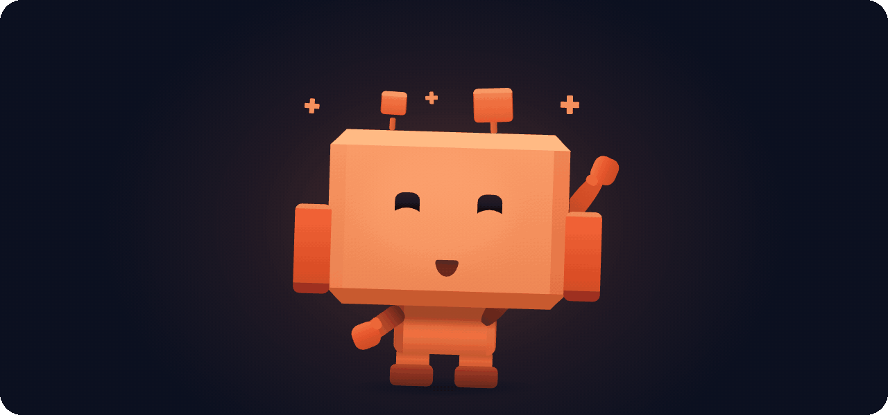
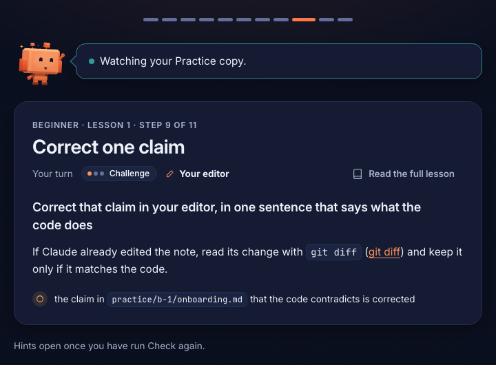
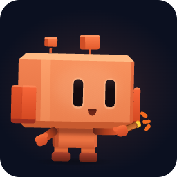
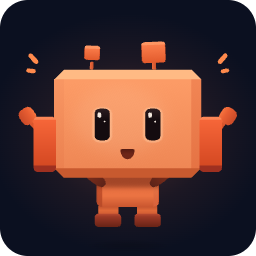
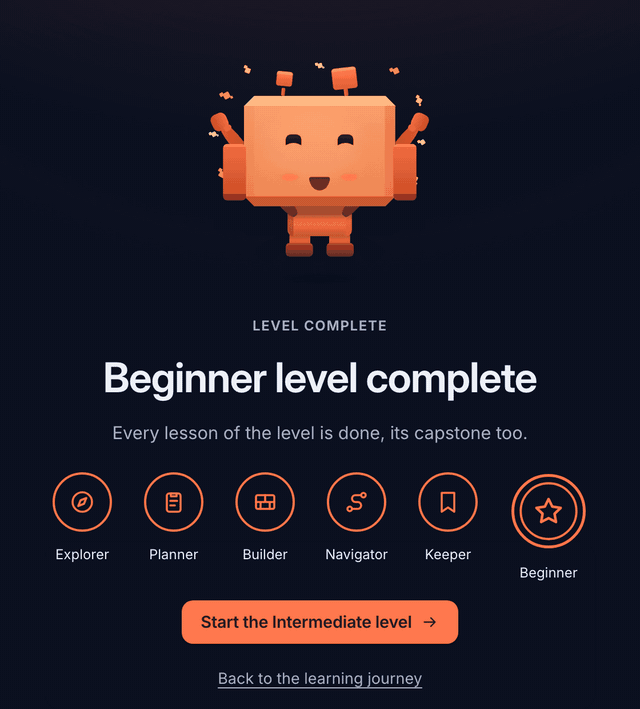
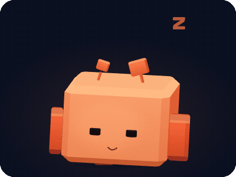

<a id="claude-code-everything-you-need-to-know-"></a>
<div align="center">

<!-- Rendered on 2026-11-05 from Pip's rig (quest/client/pip/pip.riv) in Claude Code Quest's web runtime: his Greeting, then a look down at the button below. -->


<sub><b>CLAUDE CODE QUEST</b></sub>

# Claude Code: Everything You Need to Know

**Learn Claude Code by doing it, one small step at a time, with Pip cheering you on.**

<a id="start-in-3-steps"></a>
<a href="#try-it-now"></a>

<sub><a href="#meet-pip">How it works</a> &nbsp;·&nbsp; <a href="#pick-your-level">The three levels</a> &nbsp;·&nbsp; <a href="#everything-in-the-guide">Every page</a></sub>

</div>

<a id="help-that-fades-as-you-learn"></a>
## Meet Pip

Claude Code Quest opens in your browser, beside your terminal. Read a step, try it in Claude Code, and the app checks your work. When it passes, Pip cheers.

<p align="center">
  <!-- Captured on 2026-11-02 from the Claude Code Quest app on its practice stream, against the guide baseline Claude Code v2.1.309 (stable). -->
  
  <br />
  <sub><b>Do a step, and when it passes, Pip cheers with you.</b></sub>
</p>

Miss one, and he encourages you to try again. The help fades as you get the hang of each skill, from every command, to hints, to only the goal, until you do it on your own.

<a id="install"></a>
## Try it now

You need a Claude subscription (Pro, Max, Ultra, Team or Enterprise), a Claude Console account, or access through a supported cloud provider ([Quickstart](https://code.claude.com/docs/en/quickstart)), plus Node.js LTS and git.

1. **Make your practice copy.** Open [claude-code-practice](https://github.com/wesammustafa/claude-code-practice), select **Use this template** > **Create a new repository**, and clone your copy. Or open your copy in a Codespace.
2. **Start the app** in your copy:

   ```bash
   npm run learn
   ```

3. **Keep a terminal beside it.** Claude Code Quest opens in your browser (in a Codespace, open the address it prints). It tells you what to type in the terminal and checks each step.

Claude Code Quest has no AI in it and changes none of your work. Prefer to read? Every lesson works from its page alone.

<a id="already-have-a-practice-copy"></a>
<details>
<summary>Already have a practice copy?</summary>

If you made your copy before the app moved to the browser, run these in your copy's folder, in a terminal or in PowerShell. The fetch saves the template's latest version as [`FETCH_HEAD`](https://git-scm.com/docs/git-fetch), and [`--no-overlay`](https://git-scm.com/docs/git-checkout) replaces `checks/`, `capstone/` and `learn/` as wholes:

```shell
git fetch https://github.com/wesammustafa/claude-code-practice main
git checkout --no-overlay FETCH_HEAD -- checks capstone learn
git checkout FETCH_HEAD -- .github/workflows/progress.yml .gitattributes
node checks/upgrade.mjs
```

The template's `progress.yml` workflow and `.gitattributes` replace yours. Your work moves into `project/`, with every file's contents kept (an untracked file left in `checks/`, `capstone/` or `learn/` moves to `.practice/upgrade-kept/`), and your saved progress stays where it is, so `npm run learn` opens where you left off. Run checks from `project/` now: `cd project`, then `npm run check -- b-1`. Review the change with `git status`, then commit it.

</details>

<a id="-choose-your-path"></a>
## Pick your level

Three levels take you from your first session to a setup your team shares. Start where you are and climb: every core lesson earns a Badge, and each level ends with a capstone that puts it all together. Not sure where you fit? Each level page opens with a "You're ready for this level if you can" list.

<!-- Pip's three portraits were rendered on 2026-11-05 from his rig (quest/client/pip/pip.riv) in Claude Code Quest's web runtime: Curious, Explaining and Success. -->


### Beginner
**Start here if** you're new to Claude Code.<br clear="left" />

**You'll learn to** start Claude Code safely, plan before it changes things, take one change from request to commit, and give your project a memory.\
**You'll finish by** fixing a reported bug, from plan to commit.\
**Badges:** Explorer&nbsp;· Planner&nbsp;· Builder&nbsp;· Navigator&nbsp;· Keeper&nbsp;· Beginner\
<sub>5 lessons&nbsp;· a capstone&nbsp;· 3 Electives&nbsp;· about 2½ hours</sub>\
**[Start Beginner](docs/beginner/README.md)**



### Intermediate
**Start here if** you can do what Beginner teaches.<br clear="left" />

**You'll learn to** shape Claude Code to your own project with skills, memory, permissions, hooks, subagents, MCP servers and plugins.\
**You'll finish by** getting a repository ready for a new teammate.\
**Badges:** Crafter&nbsp;· Organizer&nbsp;· Tuner&nbsp;· Guardian&nbsp;· Enforcer&nbsp;· Delegator&nbsp;· Connector&nbsp;· Curator&nbsp;· Intermediate\
<sub>8 lessons&nbsp;· a capstone&nbsp;· 4 Electives&nbsp;· about 4 hours</sub>\
**[Start Intermediate](docs/intermediate/README.md)**



### Advanced
**Start here if** you can do what Intermediate teaches.<br clear="left" />

**You'll learn to** run sessions in parallel, run Claude Code unattended in scripts and CI, share a setup with your team, and keep autonomous runs within limits you set.\
**You'll finish by** adding CI review your team can share.\
**Badges:** Brancher&nbsp;· Strategist&nbsp;· Orchestrator&nbsp;· Scripter&nbsp;· Automator&nbsp;· Steward&nbsp;· Warden&nbsp;· Advanced\
<sub>7 lessons&nbsp;· a capstone&nbsp;· 5 Electives&nbsp;· about 4 hours, plus run time</sub>\
**[Start Advanced](docs/advanced/README.md)**

<p align="center">
  <!-- Captured on 2026-11-02 from the Claude Code Quest app on its practice stream, against the guide baseline Claude Code v2.1.309 (stable); trimmed and re-encoded on 2026-11-05. -->
  
  <br />
  <sub><b>Finish a level, and Pip throws a party.</b></sub>
</p>

<a id="-whats-inside"></a><a id="-reading-tips"></a>
## Everything in the guide

<details>
<summary>Every page, by level</summary>

**Beginner:** [Level index](docs/beginner/README.md) · [Install, sign in and look around](docs/beginner/01-install-and-look-around.md) · [Permission modes and plan mode](docs/beginner/02-permission-modes-and-plan-mode.md) · [Your first change, from request to commit](docs/beginner/03-first-change.md) · [Keep a session on track](docs/beginner/04-keep-a-session-on-track.md) · [Project memory with CLAUDE.md](docs/beginner/05-project-memory.md) · [Capstone](docs/beginner/capstone.md)

**Beginner Electives:** [IDE extensions](docs/beginner/electives/ide-extensions.md) · [Screenshots and images](docs/beginner/electives/screenshots-and-images.md) · [The built-in teachers](docs/beginner/electives/built-in-teachers.md)

**Intermediate:** [Level index](docs/intermediate/README.md) · [Turn a repeated workflow into a skill](docs/intermediate/01-first-skill.md) · [Organize project memory and see what loaded](docs/intermediate/02-organize-memory.md) · [Pick the model and effort](docs/intermediate/03-model-and-effort.md) · [Permissions, settings scopes and the sandbox](docs/intermediate/04-permissions-and-sandbox.md) · [Enforce a rule with a hook](docs/intermediate/05-hooks.md) · [Delegate to a custom subagent](docs/intermediate/06-subagents.md) · [Connect a tool with MCP](docs/intermediate/07-mcp.md) · [Install and manage plugins](docs/intermediate/08-plugins.md) · [Capstone](docs/intermediate/capstone.md)

**Intermediate Electives:** [Skill patterns](docs/intermediate/electives/skill-patterns.md) · [Claude in Chrome](docs/intermediate/electives/claude-in-chrome.md) · [The status line](docs/intermediate/electives/status-line.md) · [Fast mode](docs/intermediate/electives/fast-mode.md)

**Advanced:** [Level index](docs/advanced/README.md) · [Parallel sessions with worktrees](docs/advanced/01-parallel-sessions.md) · [Choose an orchestration pattern](docs/advanced/02-orchestration-patterns.md) · [Run and save a dynamic workflow](docs/advanced/03-dynamic-workflows.md) · [Script Claude Code with `claude -p`](docs/advanced/04-headless.md) · [GitHub Actions](docs/advanced/05-github-actions.md) · [Share your setup with a team](docs/advanced/06-share-your-setup.md) · [Put bounds on autonomous runs](docs/advanced/07-bounded-runs.md) · [Capstone](docs/advanced/capstone.md) · [Beyond this guide](docs/advanced/beyond-this-guide.md)

**Advanced Electives:** [Agent teams](docs/advanced/electives/agent-teams.md) · [Agent view](docs/advanced/electives/agent-view.md) · [`/loop` and cloud scheduled tasks](docs/advanced/electives/goal-loop-routines.md) · [Testing and publishing a plugin](docs/advanced/electives/publish-a-plugin.md) · [Dev containers](docs/advanced/electives/dev-containers.md)

**Topics:** [All topics](docs/topics/README.md) · [Permissions and safety](docs/topics/permissions-and-safety.md) · [Memory and context](docs/topics/memory-and-context.md) · [Models, effort and cost](docs/topics/models-effort-and-cost.md) · [Skills](docs/topics/skills.md) · [Hooks](docs/topics/hooks.md) · [Subagents and parallel work](docs/topics/subagents-and-parallel-work.md) · [MCP](docs/topics/mcp.md) · [Plugins](docs/topics/plugins.md) · [Automation](docs/topics/automation.md)

**Reference:** [Reference index](docs/reference/README.md) · [Models and effort](docs/reference/models.md) · [Commands by level](docs/reference/commands.md) · [Feature map](docs/reference/feature-map.md) · [Further learning](docs/reference/further-reading.md) · [Glossary](docs/reference/glossary.md) · [Changelog](docs/reference/changelog.md)

**Examples:** [How to use the examples](examples/README.md)

</details>

<a id="how-the-guide-stays-current"></a>
[](CHANGELOG.md#v202612---2026-11-01) [](https://github.com/wesammustafa/Claude-Code-Everything-You-Need-to-Know/releases/latest) [](LICENSE) [](https://github.com/hesreallyhim/awesome-claude-code)

<details>
<summary>How the guide stays current</summary>

- Every lesson page carries a Stamp: the Claude Code `stable` version its claims were checked against, and the date ([The stamp](CONTRIBUTING.md#the-stamp)).
- The checks are tested too: CI builds a fresh practice copy from this repo and shows every check failing on it and passing after a full replay of the lessons ([Guide checks](.github/workflows/checks.yml)).
- Scheduled checks keep watch between editions: external links and new `stable` releases weekly, and expiry markers daily. Each opens a tracking issue ([Maintainer routine](CONTRIBUTING.md#maintainer-routine)).
- The examples are inert until you copy them into a project, and they follow a [safety contract](CONTRIBUTING.md#adding-a-skill): local only (apart from the MCP lesson's pinned server), least privilege, and a smoke test that runs without Claude.

</details>

---

<div align="center">

<!-- Rendered on 2026-11-05 from Pip's rig (quest/client/pip/pip.riv) in Claude Code Quest's web runtime: his Sleep mode. -->


<sub>Leave Pip be for a few minutes and he dozes off. He's up the moment you're back.</sub>

Found something stale? [Report it with a source](https://github.com/wesammustafa/Claude-Code-Everything-You-Need-to-Know/issues/new?template=stale-content.yml). Stuck on a lesson? Use the link at the bottom of that lesson.

**If Claude Code Quest helped you, a star helps other learners find it.**

[PolyForm Noncommercial License 1.0.0](LICENSE) · [Contributing](CONTRIBUTING.md) · [Changelog](CHANGELOG.md) · [Security](SECURITY.md)

<sub>Independent community guide, not affiliated with or endorsed by Anthropic.</sub>

</div>

<a id="links-from-the-previous-edition"></a><a id="sdlc"></a><a id="what-are-llms-and-how-do-they-differ-from-ai-tools-like-claude-code"></a><a id="what-is-claude-code"></a><a id="claude-code-setup"></a><a id="1-install"></a><a id="2-authenticate"></a><a id="3-run-your-first-prompt"></a><a id="prompt-engineering-deep-dive"></a><a id="1-explore--plan--code--commit"></a><a id="2-test-driven-workflow-write-tests--code--commit"></a><a id="4-optional-generate-a-claudemd"></a><a id="3-visual-iteration-code--screenshot--iterate--commit"></a><a id="claude-opus-46-the-latest-powerhouse"></a><a id="claude-opus-47-the-latest-flagship"></a><a id="the-claude-5-era-todays-model-lineup"></a><a id="effort-levels"></a><a id="4-effort-levels--how-hard-claude-thinks"></a><a id="claude-commands"></a><a id="built-in-slash-commands"></a><a id="day-1-essentials"></a><a id="custom-slash-commands"></a><a id="claude-skills"></a><a id="your-first-skill-in-3-minutes"></a><a id="want-more-depth"></a><a id="what-are-skills"></a><a id="built-in-vs-custom-skills"></a><a id="skills-faq"></a><a id="creating-custom-skills"></a><a id="available-skills-reference"></a><a id="using-skills-in-workflow"></a><a id="troubleshooting-skills"></a><a id="skills-best-practices"></a><a id="hooks"></a><a id="setting-up-claude-hooks"></a><a id="setting-up-hooks"></a><a id="hook-events"></a><a id="hook-input"></a><a id="hook-output"></a><a id="security-considerations"></a><a id="hook-execution-details-and-debugging"></a><a id="execution--debugging"></a><a id="2-general-purpose-subagents--when-one-claude-isnt-enough"></a><a id="3-specialized-subagents--drop-in-role-prompts"></a><a id="ai-agents"></a><a id="running-agents-in-parallel"></a><a id="subagents--running-agents-in-parallel"></a><a id="orchestrating-specialists-from-the-main-session"></a><a id="1-git-worktrees--parallel-branches-parallel-sessions"></a><a id="agent-teams-experimental---2026"></a><a id="agent-teams-experimental"></a><a id="enable-it"></a><a id="the-example-that-justifies-the-cost"></a><a id="staff-a-team-with-the-role-prompts-you-already-have"></a><a id="three-things-that-catch-people-out"></a><a id="monitoring-and-the-naming-trap"></a><a id="best-practices"></a><a id="dynamic-workflows"></a><a id="try-it-in-2-minutes--no-script-required"></a><a id="starting-your-own"></a><a id="beyond-one-terminal--the-2026-automation-surface"></a><a id="model-context-protocol-mcp"></a><a id="the-nm-problem-mcp-solves"></a><a id="three-pillars"></a><a id="the-mcp-registry--self-discovering-agents"></a><a id="the-mcp-ecosystem-today"></a><a id="fast-mode"></a><a id="fast-mode-"></a><a id="beyond-your-own-skills--the-ecosystem"></a><a id="featured-mcp-servers"></a><a id="more-mcp-servers-worth-knowing"></a><a id="super-claude-framework"></a><a id="the-bmad-method--ai-agent-framework"></a><a id="updates--deprecations-february-2026"></a><a id="updates--deprecations"></a><a id="updates--deprecations-as-of-july-2026"></a><a id="faq"></a><a id="references"></a><a id="steal-this-setup"></a><a id="5-bonus-steal-this-repos-setup"></a><a id="-when-to-use-what"></a>

<details>
<summary>Followed a link from an earlier edition?</summary>

The previous edition's README sections moved:

- **SDLC, what LLMs and Claude Code are, setup, install, sign-in and your first prompt:** moved to [Install, sign in and look around](docs/beginner/01-install-and-look-around.md).
- **Prompt engineering, explore-plan-code-commit and test-driven work:** moved to [Your first change, from request to commit](docs/beginner/03-first-change.md).
- **Generating a CLAUDE.md:** moved to [Project memory with CLAUDE.md](docs/beginner/05-project-memory.md).
- **Visual iteration with screenshots:** moved to [Give Claude a screenshot](docs/beginner/electives/screenshots-and-images.md).
- **The model lineup:** moved to [Models and effort](docs/reference/models.md).
- **Effort levels:** moved to [Pick the model and effort](docs/intermediate/03-model-and-effort.md).
- **Commands and day-one essentials:** moved to [Commands by level](docs/reference/commands.md).
- **Custom slash commands and skills:** moved to [Turn a repeated workflow into a skill](docs/intermediate/01-first-skill.md).
- **The skills reference and skills in a workflow:** moved to [Turn a repeated workflow into a skill](docs/intermediate/01-first-skill.md), which shows how to run a skill. The catalog of this repo's own skills and its workflow recipes were removed in edition v2026.10: see the [CHANGELOG](CHANGELOG.md#removed-live-config).
- **Skills troubleshooting and best practices:** moved to [Skill patterns](docs/intermediate/electives/skill-patterns.md).
- **Hooks:** moved to [Enforce a rule with a hook](docs/intermediate/05-hooks.md).
- **General-purpose and specialized subagents:** moved to [Delegate to a custom subagent](docs/intermediate/06-subagents.md). The drop-in role prompts were removed in edition v2026.10: see the [CHANGELOG](CHANGELOG.md#removed-listings).
- **AI agents and running agents in parallel:** moved to [Choose an orchestration pattern](docs/advanced/02-orchestration-patterns.md).
- **Git worktrees:** moved to [Parallel sessions with worktrees](docs/advanced/01-parallel-sessions.md).
- **Agent teams:** moved to [Agent teams](docs/advanced/electives/agent-teams.md).
- **Dynamic workflows:** moved to [Run and save a dynamic workflow](docs/advanced/03-dynamic-workflows.md).
- **The automation surface:** moved to [Feature map](docs/reference/feature-map.md).
- **Model Context Protocol (MCP):** moved to [Connect a tool with MCP](docs/intermediate/07-mcp.md).
- **Fast mode:** moved to [Fast mode](docs/intermediate/electives/fast-mode.md).
- **The skills ecosystem:** moved to [Install and manage plugins](docs/intermediate/08-plugins.md). The skills ecosystem catalog was removed in edition v2026.10: see the [CHANGELOG](CHANGELOG.md#removed-listings).
- **MCP server lists:** moved to [Connect a tool with MCP](docs/intermediate/07-mcp.md). The MCP server tables were removed in edition v2026.10: see the [CHANGELOG](CHANGELOG.md#removed-listings).
- **Super Claude and the BMAD method:** removed in edition v2026.10: listings no lesson uses. See the [CHANGELOG](CHANGELOG.md#removed-listings).
- **Updates and deprecations:** removed in edition v2026.10: the guide's summaries of Claude Code releases. See the [CHANGELOG](CHANGELOG.md#removed-changelog-mirror).
- **FAQ:** moved to [FAQ](docs/reference/faq.md), which says where each answer went.
- **References:** moved to [Further learning](docs/reference/further-reading.md).
- **Steal this setup:** moved to [Share your setup with a team](docs/advanced/06-share-your-setup.md).
- **When to use what:** moved to [When to use what](docs/intermediate/README.md#when-to-use-what).

</details>
