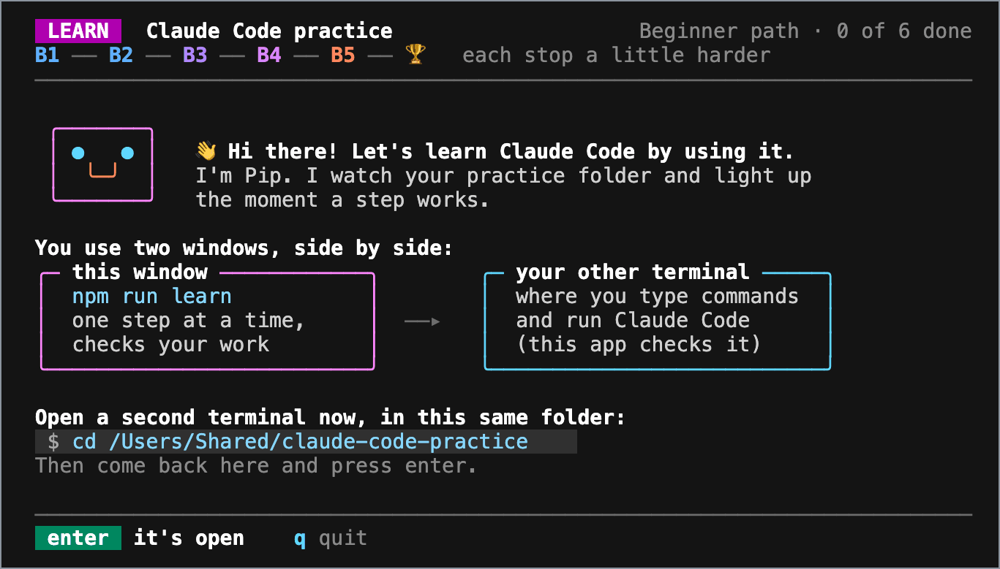
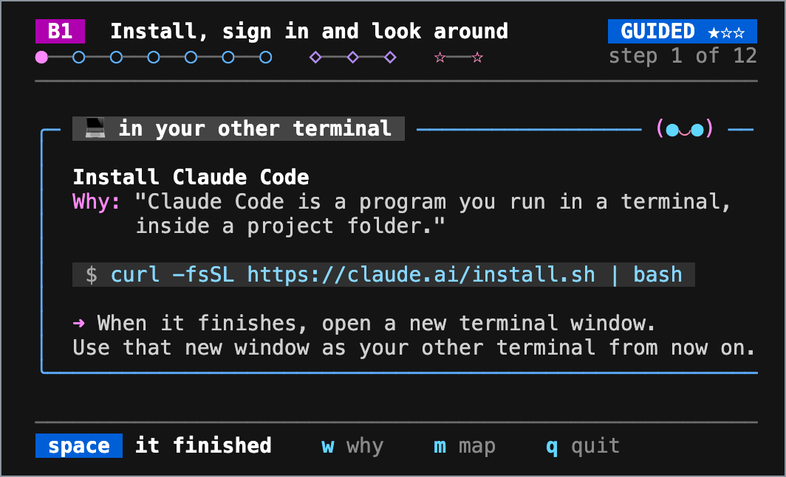
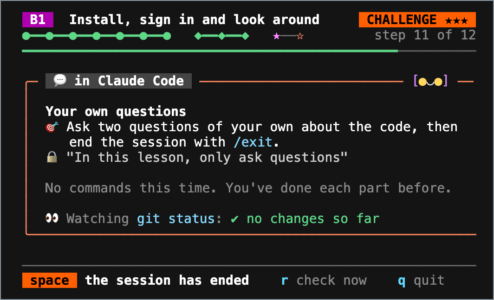

# Claude Code: Everything You Need to Know 

**Learn Claude Code in three levels, from your first session to unattended multi-agent runs.**

You learn by doing: every core lesson and capstone ends with a check you run in your own practice copy, and every Beginner lesson and the capstone run step by step in a terminal app beside Claude Code.\
**[Try it now](#try-it-now)** · [Pick your level](#pick-your-level) · [Every page](#everything-in-the-guide)

[](CHANGELOG.md#v202610---2026-10-05) [](https://github.com/wesammustafa/Claude-Code-Everything-You-Need-to-Know/releases/latest) [](LICENSE) [](https://github.com/hesreallyhim/awesome-claude-code)

<p align="center">
  <!-- Captured with Claude Code v2.1.285 (stable) on 2026-10-11. -->
  
  <br />
  <sub>The learning app, <code>npm run learn</code>, on its first run.</sub>
</p>

<a id="install"></a>
## Try it now

You need a paid Claude plan (Pro, Max, Team or Enterprise), a Claude Console account, or a supported cloud provider ([Quickstart](https://code.claude.com/docs/en/quickstart)), plus Node.js LTS and git.

1. Make your practice copy: open [claude-code-practice](https://github.com/wesammustafa/claude-code-practice), select **Use this template** > **Create a new repository**, and clone your copy. Or open your copy in a Codespace, where Node.js and Claude Code come preinstalled.
2. In your copy, start the app:

   ```bash
   npm run learn
   ```

3. Open a second terminal in the same folder. The app tells you what to type there, starting with installing Claude Code, and checks your work as you go.

The app teaches every Beginner lesson and the capstone. It has no AI in it and changes none of your work.

For Intermediate and Advanced, or if you prefer to read, every lesson works from its page alone. Each core lesson ends with a check you run from your practice copy, for example `npm run check -- b-1`: each item prints `PASS` or `FAIL`, with a hint for what to fix.

## Help that fades as you learn

The help shrinks as you get better: GUIDED shows every command, HINTED gives the goal and a hint each time you press `h`, and CHALLENGE gives just the goal.

<table>
  <tr>
    <td width="50%" valign="top"></td>
    <td width="50%" valign="top"></td>
  </tr>
  <tr>
    <td><b>Step 1 of 12, GUIDED:</b> the exact command, and the window to type it in.</td>
    <td><b>Step 11 of 12, CHALLENGE:</b> the goal alone, while the app watches your copy.</td>
  </tr>
</table>

<!-- Both captured with Claude Code v2.1.285 (stable) on 2026-10-10. -->
<sub>Beginner lesson 1, steps 1 and 11.</sub>

<a id="-choose-your-path"></a>
## Pick your level

### Beginner
**For you if** you're new to Claude Code and comfortable with a terminal and git.\
You'll take one change from request to commit, safely, and give your project a memory. About 2½ hours: 5 lessons, a capstone and 3 Electives.\
**[Start Beginner](docs/beginner/README.md)**

### Intermediate
**Ready if** you can plan a change in plan mode, review the diff and commit it, and keep a long session on track.\
You'll shape Claude Code to your project with skills, hooks, subagents, MCP and plugins. About 3 hours: 8 lessons, a capstone and 4 Electives.\
**[Start Intermediate](docs/intermediate/README.md)**

### Advanced
**Ready if** you can write a project skill, enforce a rule with a hook, delegate to a subagent and connect an MCP server.\
You'll run Claude Code in parallel, unattended in CI, and for a team, within limits you set. About 3 hours 20 minutes, plus run time: 7 lessons, a capstone and 5 Electives.\
**[Start Advanced](docs/advanced/README.md)**

<a id="-whats-inside"></a><a id="-reading-tips"></a>
## Everything in the guide

<details>
<summary>Every page, by level</summary>

**Beginner:** [Level index](docs/beginner/README.md) · [Install, sign in and look around](docs/beginner/01-install-and-look-around.md) · [Permission modes and plan mode](docs/beginner/02-permission-modes-and-plan-mode.md) · [Your first change, from request to commit](docs/beginner/03-first-change.md) · [Keep a session on track](docs/beginner/04-keep-a-session-on-track.md) · [Project memory with CLAUDE.md](docs/beginner/05-project-memory.md) · [Capstone](docs/beginner/capstone.md)

**Beginner Electives:** [IDE extensions](docs/beginner/electives/ide-extensions.md) · [Screenshots and images](docs/beginner/electives/screenshots-and-images.md) · [The built-in teachers](docs/beginner/electives/built-in-teachers.md)

**Intermediate:** [Level index](docs/intermediate/README.md) · [Turn a repeated workflow into a skill](docs/intermediate/01-first-skill.md) · [Organize project memory and see what loaded](docs/intermediate/02-organize-memory.md) · [Pick the model and effort](docs/intermediate/03-model-and-effort.md) · [Permissions, settings scopes and the sandbox](docs/intermediate/04-permissions-and-sandbox.md) · [Enforce a rule with a hook](docs/intermediate/05-hooks.md) · [Delegate to a custom subagent](docs/intermediate/06-subagents.md) · [Connect a tool with MCP](docs/intermediate/07-mcp.md) · [Install and manage plugins](docs/intermediate/08-plugins.md) · [Capstone](docs/intermediate/capstone.md)

**Intermediate Electives:** [Skill patterns](docs/intermediate/electives/skill-patterns.md) · [Claude in Chrome](docs/intermediate/electives/claude-in-chrome.md) · [The status line](docs/intermediate/electives/status-line.md) · [Fast mode](docs/intermediate/electives/fast-mode.md)

**Advanced:** [Level index](docs/advanced/README.md) · [Parallel sessions with worktrees](docs/advanced/01-parallel-sessions.md) · [Choose an orchestration pattern](docs/advanced/02-orchestration-patterns.md) · [Run and save a dynamic workflow](docs/advanced/03-dynamic-workflows.md) · [Script Claude Code with `claude -p`](docs/advanced/04-headless.md) · [GitHub Actions](docs/advanced/05-github-actions.md) · [Share your setup with a team](docs/advanced/06-share-your-setup.md) · [Put bounds on autonomous runs](docs/advanced/07-bounded-runs.md) · [Capstone](docs/advanced/capstone.md) · [Beyond this guide](docs/advanced/beyond-this-guide.md)

**Advanced Electives:** [Agent teams](docs/advanced/electives/agent-teams.md) · [Agent view](docs/advanced/electives/agent-view.md) · [`/goal`, `/loop` and routines](docs/advanced/electives/goal-loop-routines.md) · [Testing and publishing a plugin](docs/advanced/electives/publish-a-plugin.md) · [Dev containers](docs/advanced/electives/dev-containers.md)

**Topics:** [All topics](docs/topics/README.md) · [Permissions and safety](docs/topics/permissions-and-safety.md) · [Memory and context](docs/topics/memory-and-context.md) · [Models, effort and cost](docs/topics/models-effort-and-cost.md) · [Skills](docs/topics/skills.md) · [Hooks](docs/topics/hooks.md) · [Subagents and parallel work](docs/topics/subagents-and-parallel-work.md) · [MCP](docs/topics/mcp.md) · [Plugins](docs/topics/plugins.md) · [Automation](docs/topics/automation.md)

**Reference:** [Reference index](docs/reference/README.md) · [Models and effort](docs/reference/models.md) · [Commands by level](docs/reference/commands.md) · [Feature map](docs/reference/feature-map.md) · [Further learning](docs/reference/further-reading.md) · [Glossary](docs/reference/glossary.md) · [Changelog](docs/reference/changelog.md)

**Examples:** [How to use the examples](examples/README.md)

</details>

<a id="how-the-guide-stays-current"></a>
<details>
<summary>How the guide stays current</summary>

- Every lesson page carries a Stamp: the Claude Code `stable` version its claims were checked against, and the date ([The stamp](CONTRIBUTING.md#the-stamp)).
- The checks are tested too: in the practice template, CI shows every check failing on its `main` branch, where no exercise is done, and passing on its reference solutions ([Assert checks](https://github.com/wesammustafa/claude-code-practice/blob/main/.github/workflows/assert-checks.yml)).
- Scheduled checks keep watch between editions: external links and new `stable` releases weekly, expiry markers daily, and the app's quotes of the lessons weekly. Each opens a tracking issue ([Maintainer routine](CONTRIBUTING.md#maintainer-routine)).
- The examples are inert until you copy them into a project, and they follow a [safety contract](CONTRIBUTING.md#adding-a-skill): local only (apart from the MCP lesson's pinned server), least privilege, and a smoke test that runs without Claude.

</details>

---

Found something stale? [Report it with a source](https://github.com/wesammustafa/Claude-Code-Everything-You-Need-to-Know/issues/new?template=stale-content.yml). Stuck on a lesson? Use the link at the bottom of that lesson. Claude Code is a product of Anthropic; this is an independent community guide, not affiliated with or endorsed by Anthropic.

If the guide helped you, a star helps other learners find it.

[MIT License](LICENSE) · [Contributing](CONTRIBUTING.md) · [Changelog](CHANGELOG.md) · [Security](SECURITY.md)

*Mascot: [`assets/brand/claude-jumping.svg`](assets/brand/claude-jumping.svg) comes from [shanraisshan/claude-code-best-practice](https://github.com/shanraisshan/claude-code-best-practice), Copyright (c) 2025-2026 Shayan Rais, used under the [MIT License](https://github.com/shanraisshan/claude-code-best-practice/blob/main/LICENSE).*

<a id="links-from-the-previous-edition"></a><a id="sdlc"></a><a id="what-are-llms-and-how-do-they-differ-from-ai-tools-like-claude-code"></a><a id="what-is-claude-code"></a><a id="claude-code-setup"></a><a id="1-install"></a><a id="2-authenticate"></a><a id="3-run-your-first-prompt"></a><a id="prompt-engineering-deep-dive"></a><a id="1-explore--plan--code--commit"></a><a id="2-test-driven-workflow-write-tests--code--commit"></a><a id="4-optional-generate-a-claudemd"></a><a id="3-visual-iteration-code--screenshot--iterate--commit"></a><a id="claude-opus-46-the-latest-powerhouse"></a><a id="claude-opus-47-the-latest-flagship"></a><a id="the-claude-5-era-todays-model-lineup"></a><a id="effort-levels"></a><a id="4-effort-levels--how-hard-claude-thinks"></a><a id="claude-commands"></a><a id="built-in-slash-commands"></a><a id="day-1-essentials"></a><a id="custom-slash-commands"></a><a id="claude-skills"></a><a id="your-first-skill-in-3-minutes"></a><a id="want-more-depth"></a><a id="what-are-skills"></a><a id="built-in-vs-custom-skills"></a><a id="skills-faq"></a><a id="creating-custom-skills"></a><a id="available-skills-reference"></a><a id="using-skills-in-workflow"></a><a id="troubleshooting-skills"></a><a id="skills-best-practices"></a><a id="hooks"></a><a id="setting-up-claude-hooks"></a><a id="setting-up-hooks"></a><a id="hook-events"></a><a id="hook-input"></a><a id="hook-output"></a><a id="security-considerations"></a><a id="hook-execution-details-and-debugging"></a><a id="execution--debugging"></a><a id="2-general-purpose-subagents--when-one-claude-isnt-enough"></a><a id="3-specialized-subagents--drop-in-role-prompts"></a><a id="ai-agents"></a><a id="running-agents-in-parallel"></a><a id="subagents--running-agents-in-parallel"></a><a id="orchestrating-specialists-from-the-main-session"></a><a id="1-git-worktrees--parallel-branches-parallel-sessions"></a><a id="agent-teams-experimental---2026"></a><a id="agent-teams-experimental"></a><a id="enable-it"></a><a id="the-example-that-justifies-the-cost"></a><a id="staff-a-team-with-the-role-prompts-you-already-have"></a><a id="three-things-that-catch-people-out"></a><a id="monitoring-and-the-naming-trap"></a><a id="best-practices"></a><a id="dynamic-workflows"></a><a id="try-it-in-2-minutes--no-script-required"></a><a id="starting-your-own"></a><a id="beyond-one-terminal--the-2026-automation-surface"></a><a id="model-context-protocol-mcp"></a><a id="the-nm-problem-mcp-solves"></a><a id="three-pillars"></a><a id="the-mcp-registry--self-discovering-agents"></a><a id="the-mcp-ecosystem-today"></a><a id="fast-mode"></a><a id="fast-mode-"></a><a id="beyond-your-own-skills--the-ecosystem"></a><a id="featured-mcp-servers"></a><a id="more-mcp-servers-worth-knowing"></a><a id="super-claude-framework"></a><a id="the-bmad-method--ai-agent-framework"></a><a id="updates--deprecations-february-2026"></a><a id="updates--deprecations"></a><a id="updates--deprecations-as-of-july-2026"></a><a id="faq"></a><a id="references"></a><a id="steal-this-setup"></a><a id="5-bonus-steal-this-repos-setup"></a><a id="-when-to-use-what"></a>

<details>
<summary>Followed a link from an earlier edition?</summary>

The previous edition's README sections moved:

- **SDLC, what LLMs and Claude Code are, setup, install, sign-in and your first prompt:** moved to [Install, sign in and look around](docs/beginner/01-install-and-look-around.md).
- **Prompt engineering, explore-plan-code-commit and test-driven work:** moved to [Your first change, from request to commit](docs/beginner/03-first-change.md).
- **Generating a CLAUDE.md:** moved to [Project memory with CLAUDE.md](docs/beginner/05-project-memory.md).
- **Visual iteration with screenshots:** moved to [Give Claude a screenshot](docs/beginner/electives/screenshots-and-images.md).
- **The model lineup:** moved to [Models and effort](docs/reference/models.md).
- **Effort levels:** moved to [Pick the model and effort](docs/intermediate/03-model-and-effort.md).
- **Commands and day-one essentials:** moved to [Commands by level](docs/reference/commands.md).
- **Custom slash commands and skills:** moved to [Turn a repeated workflow into a skill](docs/intermediate/01-first-skill.md).
- **The skills reference and skills in a workflow:** moved to [Turn a repeated workflow into a skill](docs/intermediate/01-first-skill.md), which shows how to run a skill. The catalog of this repo's own skills and its workflow recipes were removed in edition v2026.10: see the [CHANGELOG](CHANGELOG.md#removed-live-config).
- **Skills troubleshooting and best practices:** moved to [Skill patterns](docs/intermediate/electives/skill-patterns.md).
- **Hooks:** moved to [Enforce a rule with a hook](docs/intermediate/05-hooks.md).
- **General-purpose and specialized subagents:** moved to [Delegate to a custom subagent](docs/intermediate/06-subagents.md). The drop-in role prompts were removed in edition v2026.10: see the [CHANGELOG](CHANGELOG.md#removed-listings).
- **AI agents and running agents in parallel:** moved to [Choose an orchestration pattern](docs/advanced/02-orchestration-patterns.md).
- **Git worktrees:** moved to [Parallel sessions with worktrees](docs/advanced/01-parallel-sessions.md).
- **Agent teams:** moved to [Agent teams](docs/advanced/electives/agent-teams.md).
- **Dynamic workflows:** moved to [Run and save a dynamic workflow](docs/advanced/03-dynamic-workflows.md).
- **The automation surface:** moved to [Feature map](docs/reference/feature-map.md).
- **Model Context Protocol (MCP):** moved to [Connect a tool with MCP](docs/intermediate/07-mcp.md).
- **Fast mode:** moved to [Fast mode](docs/intermediate/electives/fast-mode.md).
- **The skills ecosystem:** moved to [Install and manage plugins](docs/intermediate/08-plugins.md). The skills ecosystem catalog was removed in edition v2026.10: see the [CHANGELOG](CHANGELOG.md#removed-listings).
- **MCP server lists:** moved to [Connect a tool with MCP](docs/intermediate/07-mcp.md). The MCP server tables were removed in edition v2026.10: see the [CHANGELOG](CHANGELOG.md#removed-listings).
- **Super Claude and the BMAD method:** removed in edition v2026.10: listings no lesson uses. See the [CHANGELOG](CHANGELOG.md#removed-listings).
- **Updates and deprecations:** removed in edition v2026.10: the guide's summaries of Claude Code releases. See the [CHANGELOG](CHANGELOG.md#removed-changelog-mirror).
- **FAQ:** moved to [FAQ](docs/reference/faq.md), which says where each answer went.
- **References:** moved to [Further learning](docs/reference/further-reading.md).
- **Steal this setup:** moved to [Share your setup with a team](docs/advanced/06-share-your-setup.md).
- **When to use what:** moved to [When to use what](docs/intermediate/README.md#when-to-use-what).

</details>
