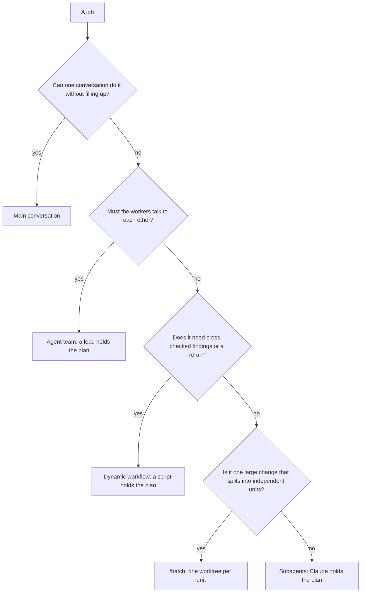

# Choose an orchestration pattern

<sub>**Advanced** · Lesson 2 of 7 · about 20 minutes · Needs: [Parallel sessions with worktrees](01-parallel-sessions.md) · Verified against Claude Code v2.1.292 (stable) on 2026-10-15</sub>

## Goal

By the end of this lesson you can choose between the main conversation, subagents, a dynamic workflow, `/batch` and an agent team by what a job needs and what it costs, and run a job as parallel subagents.

## You need

- Your repository from [lesson 1](01-parallel-sessions.md), with at least three top-level folders that hold files, and your copy of the practice template with Node.js LTS: the check runs from the copy. Set up the repository's `.practice/` folder as the [Intermediate index](../intermediate/README.md#prepare-your-own-repository) describes, if you haven't yet.
- macOS, Linux or WSL 2, and `jq`: the delegation log from [Intermediate lesson 6](../intermediate/06-subagents.md) uses it.
- Usage: moderate. Each subagent works in its own context window and sends its own requests, which count toward the same usage limits as your main conversation ([Create custom subagents](https://code.claude.com/docs/en/sub-agents)). For a lighter run, use two folders in the Worked example and two files in job 1.

## The idea

Subagents, a dynamic workflow and an agent team all split a job across workers; what differs is who holds the plan ([When to use a workflow](https://code.claude.com/docs/en/workflows#when-to-use-a-workflow)). With subagents, Claude decides turn by turn, and each result comes back into your conversation. A dynamic workflow is a script Claude writes: it holds the loop and the intermediate results, so it can run many agents, cross-check their findings and rerun the same way. In an agent team, a lead supervises teammates who message each other directly ([Choose an approach](https://code.claude.com/docs/en/agents#choose-an-approach)). The bundled `/batch` skill is subagents, packaged: it splits one large change into independent units and, once you approve its plan, runs each in its own worktree ([Commands](https://code.claude.com/docs/en/commands#all-commands)).

Every pattern past one conversation adds usage ([Why usage climbs](https://code.claude.com/docs/en/costs#why-usage-climbs-in-a-long-session)). So pick the cheapest pattern the job needs: ask these questions in order, and stop at the first answer that settles it.

A big job is not always a job to split. Keep it in the main conversation when its steps share a lot of context, such as planning, making the change and testing it ([Choose between subagents and main conversation](https://code.claude.com/docs/en/sub-agents#choose-between-subagents-and-main-conversation)). And workers that only report back to you are not a team; a team is for workers who must share findings and challenge each other as they go ([Compare with subagents](https://code.claude.com/docs/en/agent-teams#compare-with-subagents)).



> [!NOTE]
> "Agent teams are experimental and disabled by default." ([Orchestrate teams of Claude Code sessions](https://code.claude.com/docs/en/agent-teams)) This lesson names them as one option and doesn't run one; the [Agent teams](electives/agent-teams.md) Elective does.

## Worked example

1. Pick three top-level folders in your repository, such as `src`, `test` and `docs`, and start `claude`. Keep [auto mode](https://code.claude.com/docs/en/permission-modes#which-mode-a-session-starts-in), the mode it starts in, for this lesson.
2. Ask the chart's questions about one job: a newcomer's summary of each folder. One conversation would fill with file reads it won't need again, so not the main conversation ([Choose between subagents and main conversation](https://code.claude.com/docs/en/sub-agents#choose-between-subagents-and-main-conversation)). The summaries needn't talk to each other, so no team. Nothing needs cross-checking or a rerun, and nothing changes, so neither a workflow nor `/batch`: subagents.
3. Ask for them, with your own folder names, as the docs' parallel research example does ([Run parallel research](https://code.claude.com/docs/en/sub-agents#run-parallel-research)):

   ```text
   Research the src, test and docs folders in parallel using separate subagents, and give me two sentences on each.
   ```

   By default, an interactive session runs subagents in the background, so your prompt stays free ([Run subagents in foreground or background](https://code.claude.com/docs/en/sub-agents#run-subagents-in-foreground-or-background)).
4. While they work, run `/tasks`. It lists each item running in the background and lets you check on, attach to, or stop it ([Check on running work](https://code.claude.com/docs/en/agents#check-on-running-work)). Claude may start [built-in](https://code.claude.com/docs/en/sub-agents#built-in-subagents) `Explore` or `general-purpose` subagents, or forks of your conversation, so your rows will differ.
5. When the summaries arrive, run `/usage` to see what that cost. On a Pro, Max, Team or Enterprise plan, it attributes your recent usage to skills, subagents, plugins and MCP servers, and recommends changes ([Plan usage breakdown](https://code.claude.com/docs/en/costs#plan-usage-breakdown)). The figures are estimates.

## Your turn

**Brief:** pick the cheapest pattern for five backlog jobs, then run the one that needs parallel readers. Write your choices down, then run job 1.

1. Before Friday's release, audit the three largest source files for errors that are caught and then dropped. You want suspects by file and line; nothing gets fixed yet.
2. Add that audit to the release checklist for the whole codebase. The release manager has been burned by false alarms, so nothing goes on the list until it has been confirmed in the code.
3. Rename a helper that about 40 files call, update every call site in one commit, and keep the build passing.
4. A checkout test fails about one run in ten. There are three suspects: a race in a cache, an assertion that depends on the clock, and the order the tests run in. Have each suspect checked and bring back what each check found; you'll decide.
5. Move every package under `packages/` from the old logging library to the new one. Each package builds and tests on its own, and each package's change can land on its own.

**Acceptance criteria:**

- `.practice/a-2-choices.md` has one line per job, `<job number>: <pattern> because <reason>`, and each pattern is `main conversation`, `subagents`, `workflow`, `/batch` or `agent team`.
- Job 1 ran as parallel subagents, one per file, in a session you started with the delegation log from Intermediate lesson 6, `claude --settings .practice/i-6-hook.json` ([CLI reference](https://code.claude.com/docs/en/cli-reference#cli-flags)). If this repository doesn't have that file yet, save it as that lesson's [Your turn](../intermediate/06-subagents.md#your-turn) shows.
- Job 1 changed no file: the reviewers only report, and `git status` shows no change from them.
- Only job 1 ran. The other four are choices.

## Check

You are done when all of these are true:

- [ ] `.practice/a-2-choices.md` picks the cheapest pattern that fits each job.
- [ ] `.practice/i-6-agents.txt` shows at least two subagents other than Intermediate lesson 6's `test-gaps` starting: `grep -vxc test-gaps .practice/i-6-agents.txt` prints 2 or more.
- [ ] Self-check (not tested): for one real job from your own backlog, you can name its pattern, the question that decided it, and why a cheaper pattern wouldn't do.

Run `npm run check -- a-2 --dir <your repo>` from your practice copy.

If a job's pattern is wrong, ask the chart's questions in order: the check's hint names the question that settles that job. If the log has fewer than two new lines, start the session with the hook file and ask for one subagent per file, in parallel.

## Watch out

- If Claude Code asks about a background subagent's tool call, the prompt appears in your main session, and an answer that lasts beyond that one tool call, such as a grant for the rest of the session, applies to the whole session, your main conversation included ([Tools, permissions, and results of background subagents](https://code.claude.com/docs/en/sub-agents#tools-permissions-and-results-of-background-subagents)). Answer such a prompt for that one call only, and ask reviewers only to read.
- Each subagent's result returns to your conversation, and each subagent spends tokens of its own while it runs, so many detailed results crowd your context and add to your usage. Ask for short results ([Run parallel research](https://code.claude.com/docs/en/sub-agents#run-parallel-research)).
- If you've turned agent teams on, a subagent that Claude names launches as a teammate instead ([Claude spawns teammates instead of subagents](https://code.claude.com/docs/en/agent-teams#claude-spawns-teammates-instead-of-subagents)): turn teams off for this lesson.

## Go further

- [Run agents in parallel](https://code.claude.com/docs/en/agents): the official comparison of the ways Claude Code works on several tasks at once, and how to check on each.
- [Fan out across files](https://code.claude.com/docs/en/best-practices#fan-out-across-files): `/batch` for a large migration, or your own loop of `claude -p` calls.
- [Agent team token costs](https://code.claude.com/docs/en/costs#agent-team-token-costs): what drives a team's usage, and how to keep it small.

---

<sub>Sources: [Run agents in parallel](https://code.claude.com/docs/en/agents) · [Orchestrate subagents at scale with dynamic workflows](https://code.claude.com/docs/en/workflows) · [Commands](https://code.claude.com/docs/en/commands) · [Orchestrate teams of Claude Code sessions](https://code.claude.com/docs/en/agent-teams) · [Create custom subagents](https://code.claude.com/docs/en/sub-agents) · [Manage costs effectively](https://code.claude.com/docs/en/costs) · [Choose a permission mode](https://code.claude.com/docs/en/permission-modes) · [CLI reference](https://code.claude.com/docs/en/cli-reference)</sub>

<sub>← [Parallel sessions with worktrees](01-parallel-sessions.md) · [Advanced index](README.md) · [Run and save a dynamic workflow](03-dynamic-workflows.md) → · Topic: [Subagents and parallel work](../topics/subagents-and-parallel-work.md) · [Stuck on this lesson?](https://github.com/wesammustafa/Claude-Code-Everything-You-Need-to-Know/issues/new?template=lesson-feedback.yml&lesson=a-2)</sub>
