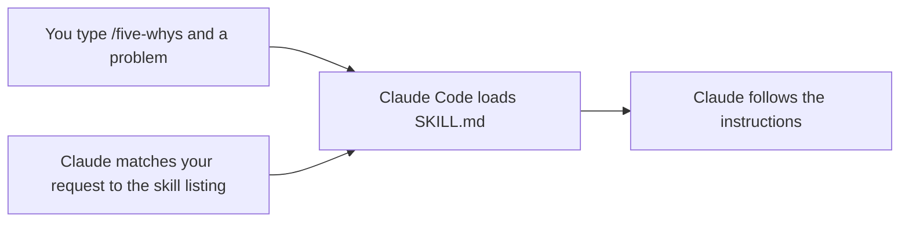

# Turn a repeated workflow into a skill

<sub>**Intermediate** · Lesson 1 of 8 · about 20 minutes · Needs: [Intermediate index](README.md) · Verified against Claude Code v2.1.292 (stable) on 2026-10-20</sub>

## Goal

By the end of this lesson you can turn a workflow you keep repeating into a project skill, choose which requests should load it, and review the change it produces.

## You need

- One of your own repositories with a test command and no uncommitted changes, and your copy of the practice template with Node.js LTS: the check runs from the copy. To practice in the template copy instead, use it for both. Set up the repository's `.practice/` folder as [Beginner lesson 1](../beginner/01-install-and-look-around.md#you-need) describes, if you haven't yet.
- Usage: light to moderate. The Your turn builds one small feature.

> [!NOTE]
> From this level on, the lessons are written for macOS, Linux and WSL 2. On Windows, run Claude Code inside WSL 2 ([Set up on Windows](https://code.claude.com/docs/en/setup#set-up-on-windows)): native Windows has no sandbox, which lesson 4 uses, and the hooks in lesson 5 are bash scripts.

## The idea

A [skill](https://code.claude.com/docs/en/skills) is a folder holding a `SKILL.md` file: YAML frontmatter that says what the skill is for, then the instructions Claude follows. A project skill lives in `.claude/skills/<name>/SKILL.md`. Commit it, and everyone who works in the repository gets it.

Claude decides whether to load a skill from its description, plus any `when_to_use` text, in the skill listing, not from the skill body ([Frontmatter reference](https://code.claude.com/docs/en/skills#frontmatter-reference)). Invoking the skill loads the full instructions:



- `$ARGUMENTS` receives the text after the skill's name ([Pass arguments to skills](https://code.claude.com/docs/en/skills#pass-arguments-to-skills)).
- `disable-model-invocation: true` makes invocation manual. Keep it for a workflow whose timing you must control, such as deployment ([Control who invokes a skill](https://code.claude.com/docs/en/skills#control-who-invokes-a-skill)).

## Worked example

1. In your repository, create the skill's folder and download this guide's example skill, [`five-whys`](../../examples/intermediate/01-first-skill/dot-claude/skills/five-whys/SKILL.md). Read it before you use it:

   ```bash
   mkdir -p .claude/skills/five-whys
   curl -fsSL https://raw.githubusercontent.com/wesammustafa/Claude-Code-Everything-You-Need-to-Know/main/examples/intermediate/01-first-skill/dot-claude/skills/five-whys/SKILL.md -o .claude/skills/five-whys/SKILL.md
   ```

   Leaving out the comment lines at the top of its frontmatter, the file holds:

   ```markdown
   ---
   name: five-whys
   description: Finds the root cause of a bug, failure or recurring problem by asking "why" until the answer is a cause you can fix. Use when the user asks why something keeps happening, or wants the root cause rather than a quick fix.
   argument-hint: "[problem]"
   ---

   Find the root cause of this problem: $ARGUMENTS
   ```

   followed by the investigation steps and the rule "Don't change any files."
2. Start `claude` in the repository and run `/skills` ([Commands](https://code.claude.com/docs/en/commands)). If the [workspace trust dialog](https://code.claude.com/docs/en/security#additional-safeguards) appears, trust only a repository you own or have reviewed. The list includes `five-whys`, a project skill because it lives in `.claude/skills/` ([Choose where skills load](https://code.claude.com/docs/en/skills#where-skills-live)).
3. Run the skill by name, with a problem from your repository. For example, in the practice copy:

   ```text
   /five-whys npm run linkcheck -- samples exits with code 1
   ```

   Read the reported chain, root cause and proposed fixes. Your wording will differ. In a terminal in your repository, run [`git status --short`](https://git-scm.com/docs/git-status): only the downloaded skill should be new. Investigate any code edit before proceeding; this skill tells Claude to change nothing.
4. Run `/clear`, then ask a question that matches the description without naming the skill. For example, in the practice copy:

   ```text
   Why does the test suite pass even though samples/guide.md has a broken link? I want the root cause, not a quick fix.
   ```

   Look for a `Skill` tool call for `five-whys` before the investigation ([Tools reference](https://code.claude.com/docs/en/tools-reference)). If it does not appear, compare the request with the description, revise the request and try in a cleared conversation.

## Your turn

The team wants a test-first workflow for requested features, while explanation-only questions should stay read-only. Decide what should trigger this coding workflow, then finish and test it in your repository.

1. Download the partial [`tdd` skill](../../examples/intermediate/01-first-skill/dot-claude/skills/tdd/SKILL.md):

   ```bash
   mkdir -p .claude/skills/tdd
   curl -fsSL https://raw.githubusercontent.com/wesammustafa/Claude-Code-Everything-You-Need-to-Know/main/examples/intermediate/01-first-skill/dot-claude/skills/tdd/SKILL.md -o .claude/skills/tdd/SKILL.md
   ```

   This is the same example path as `five-whys`, with `tdd` in its place. Read it: the frontmatter has `description: TODO` and `disable-model-invocation: true`, and the Green and Refactor steps are unfinished.
2. Decide which requests should load this skill before you edit it. Write the description for requested feature work; keep explanation-only questions outside its stated scope. Allow automatic loading for that boundary; keep deployment workflows manual.

   In your editor, finish it:
   - replace `TODO` in the description with what the skill does followed by "Use when" and the feature requests it fits;
   - write the Green and Refactor steps, keeping the Red step's style;
   - delete the `disable-model-invocation: true` line so this skill can load automatically as well as run by name.
3. Commit both reviewed skills with [git add](https://git-scm.com/docs/git-add) and [git commit](https://git-scm.com/docs/git-commit):

   ```bash
   git add .claude/skills/five-whys .claude/skills/tdd
   git commit -m "Add project skills"
   ```

   Run `git status --short` and resolve any remaining lesson changes before continuing.
4. In a session, run it by name on a small feature your repository needs. For example, in the practice copy:

   ```text
   /tdd a slugify(heading) function in src/slug.js that turns a Markdown heading into its link anchor: lowercase, punctuation dropped, spaces turned into hyphens
   ```

   Keep auto mode. It can approve edits and test runs without a prompt; if Claude Code asks, review the action before approving ([Permission modes](https://code.claude.com/docs/en/permission-modes)). Read the failing test output, the final passing result and the complete change before keeping the commit.

   In a terminal in your repository, inspect the current branch with [`git branch --show-current`](https://git-scm.com/docs/git-branch) and the commit with [`git show HEAD`](https://git-scm.com/docs/git-show). Confirm it holds the intended test and code, then save that commit: [`git rev-parse HEAD > .practice/i-1-commit.txt`](https://git-scm.com/docs/git-rev-parse). Keep the branch you reviewed; later lessons use this same repository.
5. Start with a clean repository. Clear the conversation first. Run `/clear` and ask for another small feature test-first without naming the skill, such as `Add a countHeadings(markdown) function, test-first.` Press `Esc` as soon as the `Skill` tool call for `tdd` appears, before it starts editing ([Interactive mode](https://code.claude.com/docs/en/interactive-mode)). This probe checks the trigger, so let no second feature accumulate.

   If no call appears, revise the description and retry in a cleared conversation. Check `git status --short` afterward. If edits already happened, inspect them and recover only this experiment as in [Beginner lesson 4](../beginner/04-keep-a-session-on-track.md). Rewind does not track Bash edits ([Checkpointing](https://code.claude.com/docs/en/checkpointing#bash-command-changes-not-tracked)). Finish with a clean repository.

## Check

You are done when all of these are true:

- [ ] The finished skill is committed with no TODO left: `git grep -n TODO HEAD -- .claude/skills/tdd` prints nothing.
- [ ] It can run as `/tdd` and load on its own: `git show HEAD:.claude/skills/tdd/SKILL.md` shows a description of what it does and when to use it, and no `disable-model-invocation: true`.
- [ ] The commit saved in `.practice/i-1-commit.txt` holds a test and the code it tests: `git show --stat $(cat .practice/i-1-commit.txt)` lists both.
- [ ] Self-check (not tested): `/tdd` ran the skill, its trigger fits feature requests, and a cleared conversation loaded `tdd` on its own before you stopped the probe.

Run `npm run check -- i-1 --dir <your repo>` from your practice copy, or `npm run check -- i-1` in the copy itself.

If the skill isn't committed, run `git check-ignore -v .claude/skills/tdd/SKILL.md`: an ignore rule that matches `.claude`, in a `.gitignore`, `.git/info/exclude` or your global excludes file, hides the folder from `git add`, so add the file with `git add -f`. If the invocation item fails, rewrite the description as what the skill does followed by "Use when" and the feature requests it fits, then commit again. If the commit item fails, run `/tdd` on a new small feature and let it commit the test with the code before saving that commit.

## Watch out

- A skill can pre-approve tools with `allowed-tools`, even in a `claude -p` run in a folder you've never trusted ([Pre-approve tools for a skill](https://code.claude.com/docs/en/skills#pre-approve-tools-for-a-skill)). Read the skills in a repository before you run Claude Code there.
- If `.claude/skills/` didn't exist at session startup, run `/reload-skills`, and repeat it after each later change there ([Edit a skill during a session](https://code.claude.com/docs/en/skills#live-change-detection)). After editing an invoked skill, invoke it again to load the changed instructions ([Skill content lifecycle](https://code.claude.com/docs/en/skills#skill-content-lifecycle)).

## Go further

- [Introduction to agent skills](https://academy.claude.com/courses/introduction-to-agent-skills): Claude Academy's course on writing and sharing skills.
- [Agent Skills](https://agentskills.io): the open standard that Claude Code skills follow, which works across other AI tools too.
- [Extend Claude with skills](https://code.claude.com/docs/en/skills): every frontmatter field, arguments, supporting files and running a skill in a subagent.

---

<sub>Sources: [Extend Claude with skills](https://code.claude.com/docs/en/skills) · [Advanced setup](https://code.claude.com/docs/en/setup) · [Commands](https://code.claude.com/docs/en/commands) · [Security](https://code.claude.com/docs/en/security) · [Tools reference](https://code.claude.com/docs/en/tools-reference) · [Permission modes](https://code.claude.com/docs/en/permission-modes) · [Interactive mode](https://code.claude.com/docs/en/interactive-mode) · [Checkpointing](https://code.claude.com/docs/en/checkpointing) · [git-status](https://git-scm.com/docs/git-status) · [git-branch](https://git-scm.com/docs/git-branch) · [git-show](https://git-scm.com/docs/git-show) · [git-add](https://git-scm.com/docs/git-add) · [git-commit](https://git-scm.com/docs/git-commit) · [git-rev-parse](https://git-scm.com/docs/git-rev-parse)</sub>

<sub>← [Intermediate index](README.md) · [Organize project memory and see what loaded](02-organize-memory.md) → · Topic: [Skills](../topics/skills.md) · [Stuck on this lesson?](https://github.com/wesammustafa/Claude-Code-Everything-You-Need-to-Know/issues/new?template=lesson-feedback.yml&lesson=i-1)</sub>
