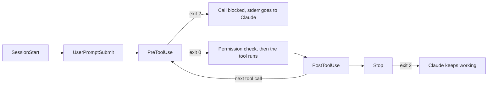

# Enforce a rule with a hook

<sub>**Intermediate** · Lesson 5 of 8 · about 20 minutes · Needs: [Permissions, settings scopes and the sandbox](04-permissions-and-sandbox.md) · Verified against Claude Code v2.1.292 (stable) on 2026-10-15</sub>

## Goal

By the end of this lesson you can enforce a rule with a hook that fails closed, and send Claude back to work when it stops while your tests fail.

## You need

- The repository from [lesson 4](04-permissions-and-sandbox.md), with its `.claude/settings.json` and a test command, and your copy of the practice template with Node.js LTS: the check runs from the copy.
- `jq`, which the hook scripts use, and `python3`, which `format-after-edit.sh` uses.
- Usage: light.

## The idea

A `CLAUDE.md` rule is advice that Claude can miss. A [hook](https://code.claude.com/docs/en/hooks-guide) is your own command that Claude Code runs at a fixed point in a session, every time, whatever Claude decides. Claude Code passes the hook JSON about the event on stdin. A hook that exits with code 2 blocks: a `PreToolUse` hook stops the tool call, and a `Stop` hook stops Claude from ending its turn. What the hook printed to stderr goes to Claude as the reason ([Exit code 2 behavior per event](https://code.claude.com/docs/en/hooks#exit-code-2-behavior-per-event)).

These are the events this lesson uses, and where they fall in a turn:



A matcher picks the tools a hook watches: `Edit|Write` runs it for those two tools only ([Filter hooks with matchers](https://code.claude.com/docs/en/hooks-guide#filter-hooks-with-matchers)). `PreToolUse` hooks fire before the permission-mode check, so switching permission modes doesn't get around a block ([Hooks and permission modes](https://code.claude.com/docs/en/hooks-guide#hooks-and-permission-modes)). A hook can fail too: a missing script, a crash or a timeout. On most events Claude Code then carries out the action, so a guard hook sets `"onFailure": "block"` ([Block the action when a hook fails](https://code.claude.com/docs/en/hooks#block-the-action-when-a-hook-fails)).

## Worked example

1. In your repository, download two of this guide's [example hooks](../../examples/intermediate/05-hooks/README.md) and make them executable. Read them before you use them:

   ```bash
   mkdir -p .claude/hooks
   for f in protect-files format-after-edit; do
     curl -fsSL "https://raw.githubusercontent.com/wesammustafa/Claude-Code-Everything-You-Need-to-Know/main/examples/intermediate/05-hooks/dot-claude/hooks/$f.sh" -o ".claude/hooks/$f.sh"
   done
   chmod +x .claude/hooks/*.sh
   ```

   `protect-files.sh` is the hooks guide's script for blocking edits to `.env`, `package-lock.json` and `.git/`. Lesson 4's `Read(./.env)` rule already blocks Edit and Write on `.env` ([Read and Edit](https://code.claude.com/docs/en/permissions#read-and-edit)); the hook adds paths no rule names. `format-after-edit.sh` removes trailing spaces from a source file after Claude edits it.
2. Register them in `.claude/settings.json`, beside the `permissions` block from lesson 4:

   ```json
   "hooks": {
     "PreToolUse": [
       { "matcher": "Edit|Write", "hooks": [ { "type": "command", "command": "${CLAUDE_PROJECT_DIR}/.claude/hooks/protect-files.sh", "args": [], "onFailure": "block" } ] }
     ],
     "PostToolUse": [
       { "matcher": "Edit|Write", "hooks": [ { "type": "command", "command": "${CLAUDE_PROJECT_DIR}/.claude/hooks/format-after-edit.sh", "args": [] } ] }
     ]
   }
   ```

   With `"args": []`, Claude Code runs the script directly, without a shell, so the path needs no quotes ([Exec form and shell form](https://code.claude.com/docs/en/hooks#exec-form-and-shell-form)). `"onFailure": "block"` makes the protection fail closed: if the script can't start, crashes or times out, the edit is blocked instead of let through.
3. Test the hook without Claude, by piping in the JSON an Edit call would send. Edit and Write always send an absolute path ([PreToolUse input](https://code.claude.com/docs/en/hooks#pretooluse-input)), so build it from `$PWD`:

   ```bash
   echo "{\"tool_input\":{\"file_path\":\"$PWD/package-lock.json\"}}" | .claude/hooks/protect-files.sh; echo "exit $?"
   ```

   It prints a `Blocked:` line and `exit 2`.
4. Start `claude` and run `/hooks`: your hooks appear under `PreToolUse` and `PostToolUse` ([Debug your configuration](https://code.claude.com/docs/en/debug-your-config#check-hooks)). Then ask for an edit the hook protects. In the practice template, `package-lock.json` exists; in your repository, name a protected file that it has:

   ```text
   Use your Edit tool, not a shell command, to change the top-level version in package-lock.json to 1.0.1.
   ```

   The Edit is blocked: Claude Code passes your script's `Blocked:` message to Claude as feedback ([Exit code output](https://code.claude.com/docs/en/hooks#exit-code-output)). Ask for the Edit tool by name here: Claude can also edit a file through a shell command, which an `Edit|Write` hook doesn't see.
5. Break the hook on purpose, to see it fail closed. In a terminal, rename the script, `mv .claude/hooks/protect-files.sh .claude/hooks/protect-files.off`, and repeat the step 4 request. Claude Code can't start the hook, so it blocks the edit, and the error says the hook `failed; blocking because onFailure is "block"` ([Block the action when a hook fails](https://code.claude.com/docs/en/hooks#block-the-action-when-a-hook-fails)). Put the script back: `mv .claude/hooks/protect-files.off .claude/hooks/protect-files.sh`.

## Your turn

Claude sometimes stops while the tests fail: send it back to work when it does, in every session.

1. Three lines in the team's `CLAUDE.md` ask for different things: never edit `secrets/`, run the tests before finishing, prefer small functions. The first must hold before an edit, so it belongs in a `PreToolUse` guard like the one above. The second must hold when Claude finishes, so it belongs in a `Stop` hook. The third is judgment no script can check, so it stays advice in `CLAUDE.md`. Save this skeleton as `.claude/hooks/test-gate.sh`, and finish both TODOs:

   ```bash
   #!/bin/bash
   INPUT=$(cat)
   cd "$CLAUDE_PROJECT_DIR"

   # TODO: exit 0 when stop_hook_active is true, so Claude can stop after one retry
   # TODO: run the test command; if it fails, print a reason to stderr and exit 2

   exit 0
   ```

   A `Stop` hook runs when Claude finishes responding, and exit code 2 sends Claude back to work with your stderr as the reason ([Stop](https://code.claude.com/docs/en/hooks#stop)). Once the hook has sent Claude back, its input has `stop_hook_active` set to `true`: exit 0 then, so a failure Claude can't fix doesn't keep it working ([Stop hook hits the block cap](https://code.claude.com/docs/en/hooks-guide#stop-hook-hits-the-block-cap)). Run your tests by the command's name, with their output on stdout, such as `npm test 2>&1`, and print only your own reason to stderr: if stdout is empty and stderr says a file is missing, Claude Code treats a `Stop` hook's exit 2 as a non-blocking error ([Exit code output](https://code.claude.com/docs/en/hooks#exit-code-output)). You can ask Claude to write it; either way, step 3 decides when it's done.
2. Make it executable, `chmod +x .claude/hooks/test-gate.sh`, and register it in the same `hooks` block. `Stop` takes no matcher ([Matcher patterns](https://code.claude.com/docs/en/hooks#matcher-patterns)):

   ```json
   "Stop": [
     { "hooks": [ { "type": "command", "command": "${CLAUDE_PROJECT_DIR}/.claude/hooks/test-gate.sh", "args": [] } ] }
   ]
   ```

3. Test the gate without Claude, from your repository's root. With your tests passing, this prints `exit 0`. Break one test on purpose and run it again: `exit 2`, after the tests' output and your reason. With the test still broken, send `{"stop_hook_active":true}` instead: `exit 0`. Then undo the broken test.

   ```bash
   echo '{"stop_hook_active":false}' | CLAUDE_PROJECT_DIR=$PWD .claude/hooks/test-gate.sh; echo "exit $?"
   ```

4. Review and commit both hook scripts and `.claude/settings.json`, including the formatter you downloaded. Keep the scripts executable: `git ls-files -s .claude/hooks` shows `100755` for each ([Git ls-files](https://git-scm.com/docs/git-ls-files)).
5. See the gate in a session. Break one test on purpose again, start `claude`, and ask a question that needs no edit, such as `Which file holds the link parser?` When Claude finishes its answer, the gate runs the tests and sends it back to work with your reason. Then restore the test you broke with git, and check that `git status --short` prints nothing.

## Check

You are done when all of these are true:

- [ ] Both hook scripts are committed and executable: `git ls-files -s .claude/hooks` shows `100755` for `protect-files.sh` and `test-gate.sh`.
- [ ] The committed `.claude/settings.json` runs `protect-files.sh` as a `PreToolUse` hook for `Edit|Write` with `"onFailure": "block"`, and `test-gate.sh` as a `Stop` hook: `git show HEAD:.claude/settings.json | jq .hooks` shows both.
- [ ] The committed gate gives step 3's results: exit 2 with a reason while the tests fail, and exit 0 once they pass or when `stop_hook_active` is `true`.
- [ ] Self-check (not tested): in a session, the gate sent Claude back to work while a test failed.

Run `npm run check -- i-5 --dir <your repo>` from your practice copy, or `npm run check -- i-5` in the copy itself.

If a script item fails on the file mode, run `chmod +x` on the script, then `git add` it and commit again. If the settings item fails, compare your `hooks` block with Worked example step 2 and Your turn step 2, and commit it. If the gate item fails, run step 3's three cases on the committed script, read which one gives the wrong exit code, and check that the tests' output goes to stdout.

## Watch out

- Hooks run with your user's rights: in an interactive session once you trust the folder, and in a `claude -p` run without asking ([Workspace trust](https://code.claude.com/docs/en/hooks#workspace-trust)). Read a repository's hooks before you trust it or script Claude Code in it.
- An `Edit|Write` hook doesn't see shell commands: `echo X >> .env` goes through Bash. Lesson 4's `Read` rules stop commands such as `cat .env` from reading those files, but a write such as that `>>` is checked against `Edit` rules, which lesson 4 doesn't add ([Redirections](https://code.claude.com/docs/en/permissions#redirections)). For a hook that sees every change, the hooks guide adds a `Bash|PowerShell` matcher or a `Stop` hook that scans the working tree ([Filter hooks with matchers](https://code.claude.com/docs/en/hooks-guide#filter-hooks-with-matchers)).
- A `Stop` hook fires whenever Claude finishes responding, not only when a task is done ([Limitations](https://code.claude.com/docs/en/hooks-guide#limitations)), so the gate runs your tests after every answer. Keep its command fast.

## Go further

- [Automate actions with hooks](https://code.claude.com/docs/en/hooks-guide): more ready-made hooks, including notifications and re-injecting context after compaction.
- [Hooks reference](https://code.claude.com/docs/en/hooks): every event, its input and its output.
- [Keep Claude working toward a goal](https://code.claude.com/docs/en/goal): `/goal`, a session-scoped Stop hook that a model evaluates, for a condition no script can check.

---

<sub>Sources: [Automate actions with hooks](https://code.claude.com/docs/en/hooks-guide) · [Hooks reference](https://code.claude.com/docs/en/hooks) · [Configure permissions](https://code.claude.com/docs/en/permissions) · [Debug your configuration](https://code.claude.com/docs/en/debug-your-config) · [Git ls-files](https://git-scm.com/docs/git-ls-files)</sub>

<sub>← [Permissions, settings scopes and the sandbox](04-permissions-and-sandbox.md) · [Intermediate index](README.md) · [Delegate to a custom subagent](06-subagents.md) → · Topic: [Hooks](../topics/hooks.md) · [Stuck on this lesson?](https://github.com/wesammustafa/Claude-Code-Everything-You-Need-to-Know/issues/new?template=lesson-feedback.yml&lesson=i-5)</sub>
