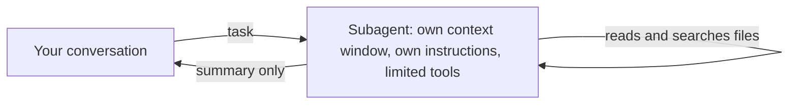

# Delegate to a custom subagent

<sub>**Intermediate** · Lesson 6 of 8 · about 25 minutes · Needs: [Turn a repeated workflow into a skill](01-first-skill.md), [Permissions, settings scopes and the sandbox](04-permissions-and-sandbox.md) · Verified against Claude Code v2.1.292 (stable) on 2026-10-15</sub>

## Goal

By the end of this lesson you can write a subagent that has only the tools its task needs, and delegate work to it.

## You need

- One of your own repositories, and your copy of the practice template with Node.js LTS: the check runs from the copy. To practice in the template copy instead, use it for both.
- The commit you made with `/tdd` in [lesson 1](01-first-skill.md): its SHA is in `.practice/i-1-commit.txt`.
- `jq`, for the delegation log in Your turn.
- Usage: light to moderate. Each delegation starts a second context window.

## The idea

A [subagent](https://code.claude.com/docs/en/sub-agents) is a separate Claude that your session hands a task to. It works in its own context window, with its own instructions and only the tools you give it, and returns a summary. Its file reads and search results stay out of your conversation:



A project subagent is a Markdown file in `.claude/agents/`: frontmatter with a `name` and a `description` (both required), an optional `tools` list, then the instructions it works from. Claude reads the description to decide when to delegate; you can also name the subagent in your request.

Delegate a task whose output you don't need in full, or that should run with restricted tools. Keep it in the main conversation when it needs back-and-forth, or when it's a quick, targeted change ([Choose between subagents and main conversation](https://code.claude.com/docs/en/sub-agents#choose-between-subagents-and-main-conversation)).

## Worked example

1. In your repository, download the example [`code-reviewer`](../../examples/intermediate/06-subagents/dot-claude/agents/code-reviewer.md) and read it:

   ```bash
   mkdir -p .claude/agents
   curl -fsSL https://raw.githubusercontent.com/wesammustafa/Claude-Code-Everything-You-Need-to-Know/main/examples/intermediate/06-subagents/dot-claude/agents/code-reviewer.md -o .claude/agents/code-reviewer.md
   ```

   Its frontmatter limits it to three tools, so it can read and search files but can't edit them or run commands:

   ```yaml
   name: code-reviewer
   tools: Read, Grep, Glob
   ```

2. Start `claude`. If a session was already running when you created `.claude/agents/`, restart it: Claude Code watches only the agent folders that existed when the session started ([Write subagent files](https://code.claude.com/docs/en/sub-agents#write-subagent-files)). Keep [auto mode](https://code.claude.com/docs/en/permission-modes#which-mode-a-session-starts-in) for this lesson.
3. Ask your main conversation to collect the diff of your lesson 1 commit and give it to the custom reviewer:

   ```text
   Use the code-reviewer agent to review the commit in .practice/i-1-commit.txt: pass it that commit's diff and filenames. Ask for a report only. Do not edit files.
   ```

   The reviewer can't run `git diff`, so your main conversation must supply it. Wait for the completed report; `/tasks` lists background work ([Commands](https://code.claude.com/docs/en/commands)). Its findings come back as a summary. Your wording will differ.
4. Review the same commit with the bundled skill, which accepts a Git revision range ([Review locally with `/code-review`](https://code.claude.com/docs/en/code-review-local#choose-what-to-review)). Put the SHA from `.practice/i-1-commit.txt` in place of `<sha>`:

   ```text
   /code-review <sha>^..<sha>
   ```

   Without `--fix`, the bundled skill asks for a report only ([What the review reads and edits](https://code.claude.com/docs/en/code-review-local#what-the-review-reads-and-edits)). That instruction differs from the custom reviewer's tool restriction: the custom reviewer has no file-editing or shell tool. Run `git status --short` after each review to inspect what actually happened ([Git status](https://git-scm.com/docs/git-status)).
5. Compare the reports against the same diff. A reviewer asked to find gaps usually reports some, even when the work is sound: act on a finding that affects correctness or the requirements, after a targeted test shows it is real ([Add an adversarial review step](https://code.claude.com/docs/en/best-practices#add-an-adversarial-review-step)). Review and commit any justified fix and `.claude/agents/code-reviewer.md`.

## Your turn

Hand the noisy search for untested code to a read-only helper, and keep only its findings. Finish a subagent that finds code no test calls, then delegate to it.

1. A teammate asks to find missing tests and add them. Decide which part belongs in a read-only report and which part stays in your main conversation. Save this as `.claude/agents/test-gaps.md`, and replace both `TODO`s. Give it only read-only tools:

   ```markdown
   ---
   name: test-gaps
   description: TODO
   tools: TODO
   ---

   List exported functions no test calls. Never change files.
   Report each by file and suggest a test. If all are called, say so.
   ```

   Write the description on one line, with at least eight words: what it reports and when Claude should delegate to it. Keep writing tests outside its stated task. A call in a test is a lead for investigation, not proof that the function's behavior is well tested. For tools, give it only `Read`, `Grep` and `Glob`: it needs no shell and no web tool.
2. Commit it.
3. Save this delegation log to `.practice/i-6-hook.json`. It is a [`SubagentStart` hook](https://code.claude.com/docs/en/hooks#subagentstart) that appends the name of each subagent Claude starts to `.practice/i-6-agents.txt`, and logs nothing else:

   ```json
   {"hooks":{"SubagentStart":[{"hooks":[{
     "type":"command","command":"jq -r '.agent_type' >> \"$CLAUDE_PROJECT_DIR/.practice/i-6-agents.txt\""
   }]}]}}
   ```

4. End your current session. Start `claude --settings .practice/i-6-hook.json` ([CLI reference](https://code.claude.com/docs/en/cli-reference#cli-flags)) and ask `Use the test-gaps agent to list the functions no test calls.` Wait for its completed report and compare a candidate with the actual tests. Reporting that every export is called is a valid result. Let the main conversation write any test you decide is needed; the subagent stays read-only.

## Check

You are done when all of these are true:

- [ ] The committed subagent has its name and a description of when to use it: `git show HEAD:.claude/agents/test-gaps.md | head -5`.
- [ ] Its tools only read code: the `tools` line names tools such as `Read`, `Grep` and `Glob`, and no tool that edits files, runs commands or reaches the web, such as `Edit`, `Bash` or `WebFetch`.
- [ ] Claude delegated to it: `grep -x test-gaps .practice/i-6-agents.txt` prints `test-gaps`.
- [ ] Self-check (not tested): the subagent's file reads stayed out of your conversation, and only its summary came back. You compared both reviews of the same commit with the actual diff, and tested a finding before acting on it.

Run `npm run check -- i-6 --dir <your repo>` from your practice copy, or `npm run check -- i-6` in the copy itself.

If the first item fails, check the frontmatter: Claude Code skips an agent file without a `name`, and one with a `name` but no `description`. If the tools item fails, remove each tool that can change files, run commands or reach the web; without a `tools` line, a subagent gets every tool. If the log has no `test-gaps` line, start the session with the hook file and name the subagent in your request.

## Watch out

- A subagent that lists `Bash` can still change files through shell commands, such as a `sed` edit or a [`> file` redirect](https://code.claude.com/docs/en/permissions#redirections), even without `Edit` or `Write`. Leave `Bash` out, and let your session pass it what a command would have shown.

## Go further

- [Introduction to subagents](https://academy.claude.com/courses/introduction-to-subagents): Claude Academy's course on designing and using subagents.
- [How and when to use subagents in Claude Code](https://claude.com/blog/subagents-in-claude-code): Anthropic on when to delegate and when to stay in the main session.
- [Create custom subagents](https://code.claude.com/docs/en/sub-agents): every frontmatter field, background subagents and resuming one.

---

<sub>Sources: [Create custom subagents](https://code.claude.com/docs/en/sub-agents) · [Review locally with /code-review](https://code.claude.com/docs/en/code-review-local) · [Best practices](https://code.claude.com/docs/en/best-practices) · [Hooks reference](https://code.claude.com/docs/en/hooks) · [Configure permissions](https://code.claude.com/docs/en/permissions) · [Choose a permission mode](https://code.claude.com/docs/en/permission-modes) · [Commands](https://code.claude.com/docs/en/commands) · [CLI reference](https://code.claude.com/docs/en/cli-reference) · [Git status](https://git-scm.com/docs/git-status)</sub>

<sub>← [Enforce a rule with a hook](05-hooks.md) · [Intermediate index](README.md) · [Connect a tool with MCP](07-mcp.md) → · Topic: [Subagents and parallel work](../topics/subagents-and-parallel-work.md) · [Stuck on this lesson?](https://github.com/wesammustafa/Claude-Code-Everything-You-Need-to-Know/issues/new?template=lesson-feedback.yml&lesson=i-6)</sub>
