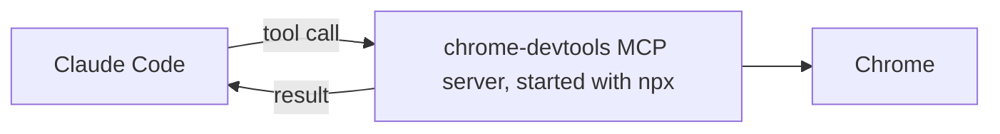

# Connect a tool with MCP

<sub>**Intermediate** · Lesson 7 of 8 · about 25 minutes · Needs: [Permissions, settings scopes and the sandbox](04-permissions-and-sandbox.md) · Verified against Claude Code v2.1.308 (stable) on 2026-10-25</sub>

## Goal

By the end of this lesson you can connect a version-pinned MCP server at the right scope and use its browser evidence to find and fix a page error.

## You need

- One of your own repositories, and your copy of the practice template with Node.js LTS: the check runs from the copy. To practice in the template copy instead, use it for both. Set up the repository's `.practice/` folder as the [Intermediate index](README.md#prepare-your-own-repository) describes, if you haven't yet.
- Chrome, and npm, which comes with Node.js: the server runs through `npx` ([upstream requirements](https://github.com/ChromeDevTools/chrome-devtools-mcp/blob/chrome-devtools-mcp-v1.10.1/README.md#requirements)).
- Usage: light.

## The idea

[MCP](https://code.claude.com/docs/en/mcp) (the Model Context Protocol) lets Claude Code use tools that another program provides: an MCP server. This lesson uses [Chrome DevTools MCP](https://github.com/ChromeDevTools/chrome-devtools-mcp) (Vendor: Google) to inspect a local page's console, diagnose its error and capture the repair ([tool reference](https://github.com/ChromeDevTools/chrome-devtools-mcp/blob/chrome-devtools-mcp-v1.10.1/docs/tool-reference.md)).



Where you add a server decides who gets it ([MCP installation scopes](https://code.claude.com/docs/en/mcp#mcp-installation-scopes)):

| Scope | Who gets it | Stored in |
|---|---|---|
| Local, the default | You, in this project | `~/.claude.json` |
| Project | Everyone who works in the project | `.mcp.json` at the project root, committed |
| User | You, in every project | `~/.claude.json` |

In an interactive session, Claude Code asks you to approve a project's servers before it uses them. Approving a server and approving an individual tool call are separate decisions. A shared `.mcp.json` never holds a token: write `${VAR}` and each teammate sets the variable ([Environment variable expansion](https://code.claude.com/docs/en/mcp#environment-variable-expansion-in-mcp-json)). With tool search, the default, only tool names and server instructions load at session start ([Scale with MCP Tool Search](https://code.claude.com/docs/en/mcp#scale-with-mcp-tool-search)).

> [!WARNING]
> Data that leaves your machine. By default, Chrome DevTools MCP sends usage statistics to Google, may send the URLs of performance traces to Google's CrUX API, and checks npm for updates ([upstream README](https://github.com/ChromeDevTools/chrome-devtools-mcp/blob/chrome-devtools-mcp-v1.10.1/README.md)). This lesson always runs it with all three turned off. The pages Claude opens still load from the web, and the server shows Claude everything in that browser. Use the isolated browser only for this local demo, with no personal accounts or sensitive pages.

## Worked example

1. Save this page as `.practice/demo.html` in your repository. It has a planted browser bug; leave it unfixed:

   ```html
   <!doctype html>
   <title>Linkcheck demo</title>
   <a href="#guide">Guide</a> <a href="#reference">Reference</a>
   <p id="link-count">Counting links...</p>
   <script>
   const links = document.querySelectorAll('a');
   document.querySelector('#link-total').textContent = `${links.length} links ready`;
   </script>
   ```

2. Add the server at local scope, for yourself. Run this in your repository's terminal. The version is pinned, `--isolated` gives the browser a temporary profile, and the other two flags and the variable turn the data flows off ([configuration](https://github.com/ChromeDevTools/chrome-devtools-mcp/blob/chrome-devtools-mcp-v1.10.1/docs/configuration.md)). Everything after `--` is the server's own command:

   ```bash
   claude mcp add --env CHROME_DEVTOOLS_MCP_NO_UPDATE_CHECKS=1 --transport stdio chrome-devtools -- npx -y chrome-devtools-mcp@1.10.1 --isolated --no-usage-statistics --no-performance-crux
   ```

3. Run `claude mcp get chrome-devtools` in the same repository. It shows which scope holds the server, local here, and the server's status ([Find your configuration on disk](https://code.claude.com/docs/en/mcp-quickstart#find-your-configuration-on-disk)).
4. Start a Manual session with `claude --permission-mode default` for this first MCP tool use ([Choose a permission mode](https://code.claude.com/docs/en/permission-modes#available-modes)). Run `/mcp` and select `chrome-devtools` to inspect its status and tools. The list shows a tool count; select the server to see the tool list ([Tool availability](https://code.claude.com/docs/en/mcp#tool-availability)). Then ask:

   ```text
   Use the chrome-devtools tools to open .practice/demo.html as a file: URL. Read the title, visible count and console error. Report the error and its source location, without editing any files.
   ```

   If Claude Code asks about a tool call, inspect the tool name and inputs, then approve only that call ([Configure permissions](https://code.claude.com/docs/en/permissions#manage-permissions)). Do not grant a standing approval for this exercise. Read the actual tool output: the count stays at `Counting links...`, and the script fails when it tries to update an element that wasn't found. Your browser's error wording may differ. After reviewing the first call, press `Shift+Tab` until the status bar reads `⏵⏵ auto mode on`, if auto mode is available, so later calls can proceed under its checks ([Switch permission modes](https://code.claude.com/docs/en/permission-modes#switch-permission-modes)).

## Your turn

Give every teammate the exact browser server you reviewed, then use it to fix the broken demo page.

1. In the same repository's terminal, remove your local copy, which would otherwise take precedence over a project server of the same name ([Scope hierarchy and precedence](https://code.claude.com/docs/en/mcp#scope-hierarchy-and-precedence)): `claude mcp remove chrome-devtools -s local`. If it reports no local server, confirm you are in the repository where you added it; local scope belongs to that project.
2. Add the same server at project scope. The command writes `.mcp.json` at the repository root, beside any servers already in it ([Project scope](https://code.claude.com/docs/en/mcp#project-scope)):

   ```bash
   claude mcp add --scope project --env CHROME_DEVTOOLS_MCP_NO_UPDATE_CHECKS=1 --transport stdio chrome-devtools -- npx -y chrome-devtools-mcp@1.10.1 --isolated --no-usage-statistics --no-performance-crux
   ```

3. Read `.mcp.json` before you commit it: check the pinned version, the two flags and the variable, and that it holds no token. Then commit it.
4. Exit the session from the Worked example, then start `claude` again in your repository. When it asks about the project's new server, approve it only if you have reviewed the server's command and arguments in `.mcp.json`: they decide what code runs on your machine. If `.mcp.json` names a server you haven't reviewed, decline and investigate. Run `/mcp`, select the server and check that it connected ([Edit .mcp.json directly](https://code.claude.com/docs/en/mcp-quickstart#edit-mcp-json-directly)). Keep auto mode for the repair.
5. Use the project's browser tools to reload `.practice/demo.html` and read its console before editing. Decide whether the element lookup or the count calculation is at fault: compare the reported source line with the page's existing result element. Fix the mismatched lookup while keeping the calculation; hiding the exception would leave the page broken. Ask Claude to make that focused repair, then use the MCP tools to reload and verify the visible count and console. The result should read `2 links ready` with no script error. Then have the server save the repaired page as a PNG to `.practice/i-7-page.png` ([Screenshot tool](https://github.com/ChromeDevTools/chrome-devtools-mcp/blob/chrome-devtools-mcp-v1.10.1/docs/tool-reference.md#take_screenshot)).

## Check

You are done when all of these are true:

- [ ] The committed `.mcp.json` pins the package to an exact version and turns off usage statistics, CrUX lookups and update checks: `git show HEAD:.mcp.json | jq '.mcpServers["chrome-devtools"]'` shows them.
- [ ] `.practice/i-7-page.png` holds a PNG image of the repaired page, saved after the repair.
- [ ] The demo script displays `2 links ready` without a script error; a hardcoded count doesn't pass.
- [ ] Self-check (not tested): you reviewed the first MCP tool call, used the project's server to read the real console error, and verified the repaired count and clean console after reloading.

Run `npm run check -- i-7 --dir <your repo>` from your practice copy, or `npm run check -- i-7` in the copy itself.

If the server item fails, compare each argument with the Worked example's command: `@latest` isn't pinned. If the capture is missing or older than the repair, confirm the server connected, then ask it to save the PNG again. If the demo item fails, revisit Your turn step 5: removing the script or swallowing its error doesn't repair the count.

## Watch out

- A `claude -p` run loads a project's servers without asking ([Project scope](https://code.claude.com/docs/en/mcp#project-scope)). Read a repository's `.mcp.json` before you script Claude Code in it. A quiet tool call in auto mode doesn't prove that you granted a permanent permission.
- To be asked about a project's servers again, run `claude mcp reset-project-choices`, then restart Claude Code. If you missed the approval prompt, open `/mcp` to approve the server there.

Third-party: it can run code on your machine or give Claude new tools. Review it before installing; this guide does not audit it.

Listings checked against the listing bar on 2026-10-06.

## Go further

- [Connect to MCP servers](https://code.claude.com/docs/en/mcp-quickstart): adding remote servers, signing in to them, and other ways to add one.
- [The MCP Registry](https://registry.modelcontextprotocol.io): the MCP project's list of public servers, which it labels "preview" ([About](https://modelcontextprotocol.io/registry/about)).
- [What is the Model Context Protocol (MCP)?](https://modelcontextprotocol.io/docs/getting-started/intro): the protocol itself.

---

<sub>Sources: [Connect Claude Code to tools via MCP](https://code.claude.com/docs/en/mcp) · [Connect to MCP servers](https://code.claude.com/docs/en/mcp-quickstart) · [Configure permissions](https://code.claude.com/docs/en/permissions) · [Choose a permission mode](https://code.claude.com/docs/en/permission-modes) · [Chrome DevTools MCP README](https://github.com/ChromeDevTools/chrome-devtools-mcp/blob/chrome-devtools-mcp-v1.10.1/README.md) · [Chrome DevTools MCP configuration](https://github.com/ChromeDevTools/chrome-devtools-mcp/blob/chrome-devtools-mcp-v1.10.1/docs/configuration.md) · [Chrome DevTools MCP tools](https://github.com/ChromeDevTools/chrome-devtools-mcp/blob/chrome-devtools-mcp-v1.10.1/docs/tool-reference.md) · [The MCP Registry](https://modelcontextprotocol.io/registry/about)</sub>

<sub>← [Delegate to a custom subagent](06-subagents.md) · [Intermediate index](README.md) · [Install and manage plugins](08-plugins.md) → · Topic: [MCP](../topics/mcp.md) · [Stuck on this lesson?](https://github.com/wesammustafa/Claude-Code-Everything-You-Need-to-Know/issues/new?template=lesson-feedback.yml&lesson=i-7)</sub>
